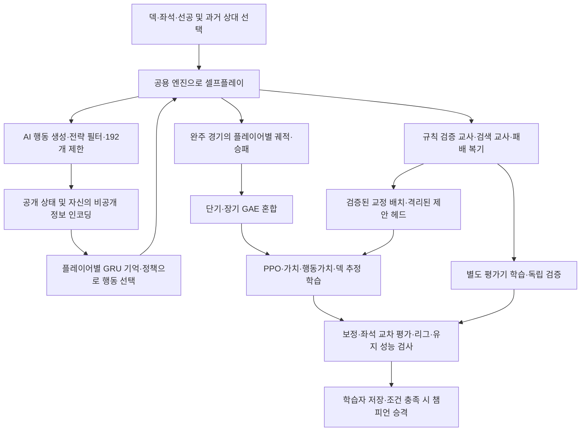

AI 학습 구조 검증 — 2026-09-05
================================

> 이 문서는 수정 전 감사 기록입니다. 지적 사항의 수정 내용과 최종 검증 결과는 [수정 완료 보고서](ai-training-fixes-2026-09-05.md)를 확인해 주십시오. 아래 수치와 오류 재현 스크립트는 당시 상태를 기록한 것입니다.

현재 작업 트리의 학습·추론·행동 생성·숨은 상태 샘플링을 조사했습니다. 학습 입력 및 행동 공간에 수정이 필요한 문제가 있고, 확실한 중복 계산도 있습니다. 더 오래 학습하는 것만으로 해결되지 않는 문제부터 처리하시는 편이 좋습니다.

제품 코드와 체크포인트는 수정하지 않았습니다. 조사 시작 시 이미 존재하던 미커밋 변경을 포함한 상태가 검증 대상입니다. 핵심 소스 8개의 SHA-256과 수치 결과를 [결과 JSON](ai-training-audit-2026-09-05-results.json)에 보관했습니다. 재현용 [진단 스크립트](ai-training-audit-2026-09-05.mjs)는 현재 문제가 발생한다는 사실을 assert하는 스크립트이므로, 실행 성공을 제품의 정상 판정으로 해석하시면 안 됩니다.

**현재 구조**



- 진입점은 `scripts/train-neural-ai.mjs`, 수집은 `src/ai/neural/selfplay.mjs`, 학습 배치 구성은 `trainer.mjs`, 신경망과 손실은 `model.mjs`입니다. `bootstrap-neural-ai.mjs`/`imitation.mjs`에는 별도 모방 초기화 경로가 있습니다.
- 기본 카드풀은 Origins이며 학습 덱 기본값은 Sett, Annie, Kai’Sa, Master Yi, Leona 5개입니다. 기본값 자체를 전체 카드풀 학습으로 해석하시면 안 됩니다.
- 현재 평면 입력은 상태 3,704차원, 행동 464차원, GRU 기억 64차원입니다. 합법 후보 중 최대 192개를 처리하고 궤적은 최대 128스텝씩 나눕니다. 정책 외에 승패 가치, 행동 가치, 상대 덱, 진단, 격리된 교사 제안 출력이 있고 별도 평가기 구조도 있습니다.
- 결제는 대부분 공용 결제 계획기가 처리하고, 멀리건은 반환 카드 조합 단위로 행동을 만듭니다. 따라서 모든 룬 클릭을 PPO 스텝으로 처리하는 구조는 아닙니다.
- 기본 GAE 설정은 `gamma=0.997`, `lambda=0.95`, 장기 `lambda=0.985`, 장기 비중 `0.6`입니다. 기본 학습률은 `0.00015`입니다. 전략 shaping과 진단 보상을 승패 보상에 직접 더하는 가중치는 현재 기본 경로에서 0입니다.
- 저장소의 배포용 `neural-champion.json`은 조사 시 모델 버전 4, 세대 0, 누적 256경기이고 별도 evaluatorArchitecture가 없습니다. 이는 저장 파일의 상태이며 현재 실행 중인 모든 학습 작업의 상태를 뜻하지 않습니다.
- `docs/ai-training.md`의 “모든 등록 카드 전용 슬롯”, “세 개 헤드”, 초기 shaping 설명은 현재 코드와 차이가 있습니다.

**먼저 수정해야 할 문제**

1. **[P1] 192개 제한 후 행동 인덱스와 증거에 기록하는 행동 목록이 어긋납니다.**

   `selfplay.mjs:547`은 전체 후보의 `legal.map(actionKey)`를 보존하는데 `selectedIndex`와 신경망 행동 배열은 `encodeActionSet`이 추린 후보의 인덱스입니다. `selfplay.mjs:3135`/`:3197`은 그 인덱스로 다시 전체 목록을 읽습니다.

   준비된 유닛 10개를 둔 재현에서는 후보 352개가 192개로 줄었으며, **159개 슬롯에서 실제 인코딩된 행동과 기록 목록의 같은 인덱스가 달랐습니다. 최초 불일치는 33번 인덱스**였습니다. 엔진 증명은 다른 행동 이름에 연결될 수 있고, 독립 감사 증거는 일치 검사에서 버려질 수 있습니다. PPO의 `selectedIndex` 자체가 다른 행동 벡터를 선택했다는 뜻은 아니며, 특히 교정·감사 증거의 식별 및 연결 문제입니다.

   전체 후보 목록과 인코딩된 후보 목록을 별도 필드로 보관하고, 모든 정책·교사 인덱스는 후자의 목록에만 대응시켜야 합니다. 기존 검사기는 주로 선택 키의 전체 목록 포함 여부와 길이만 검사하여 이 오류를 놓칩니다. 근거: `encoding.mjs:241`, `selfplay.mjs:852`, `selfplay.mjs:3120`, `scripts/training-safety.mjs`의 행동 manifest 검사.

2. **[P1] 합법적인 4개 이상 부분집합의 동시 이동을 생성하지 않습니다.**

   `src/ai/actions.mjs:806`의 `batchMoveCandidates`는 2개·3개 조합과 전체 유닛 조합만 만듭니다. 모든 유닛을 모을 때 소진 여부나 서로 다른 출발지의 이동 가능 여부도 먼저 분리하지 않습니다.

   **2 Might 유닛 4개가 준비되어 있고 1개가 소진된 상태에서 7 Might 방어 유닛을 공격**하는 사례를 재현했습니다. 준비된 4개 이동은 공용 엔진이 허용합니다. 하지만 4개 조합이 없고, 전체 5개 이동은 소진된 유닛 때문에 불법이며, 1~3개 이동은 `noOpponentImpact` 필터에 걸려 **AI의 해당 전장 공격 후보는 0개**입니다. 학습량과 무관하게 이 동시 공격을 선택할 수 없습니다.

   목적지별 실제 이동 가능 유닛을 먼저 묶고 4개 이상 부분집합도 전술적으로 보존하는 후보 생성이 필요합니다. 모든 부분집합을 무제한 열거하는 해결책은 계산량 문제를 키우므로 피하시는 편이 좋습니다.

3. **[P1] 이번 턴의 전장 득점 이력을 입력에서 구분하지 못합니다.**

   엔진 `src/engine.mjs:29323`은 `turnScoredBattlefields`로 전장 중복 득점과 마지막 점수의 정복 조건을 판단합니다. 그러나 평면 관측·인코딩에는 이 이력이 없습니다.

   7점, 동일한 보드·손패·행동에서 다른 전장을 이미 득점했는지만 바꾼 두 상태를 만들었습니다. **상태 벡터 차이 0개, 이동 행동 벡터 차이 0개**였지만, 같은 이동 후 양측이 패스하면 한쪽은 **7점 유지 및 카드 드로우**, 다른 쪽은 **8점 승리**였습니다. 공식 안내서도 마지막 정복 점수에 같은 턴의 전장 득점 조건이 있음을 명시합니다. [Riot 공식 플레이 안내서, 13쪽](https://cmsassets.rgpub.io/sanity/files/dsfx7636/news_live/3694623875b098a3d0daed824e242b3a0e68dae6.pdf).

   GRU가 이전 관측으로 일부 이력을 추론할 가능성은 있습니다. 따라서 전체 과거 입력까지 항상 같다는 주장은 하지 않습니다. 다만 단일 상태로 평가하는 경로는 이 입력으로 두 상황을 구별할 수 없습니다. 플레이어별·전장별 득점 완료 플래그를 명시해야 합니다. 근거: `observation.mjs:128`, `encoding.mjs:108`, `model.mjs:326`.

4. **[P1] 공개된 상대 손패까지 다시 샘플링할 숨은 슬롯으로 세어, 유효한 상태를 무효 처리합니다.**

   공개 효과가 있으면 `belief.mjs:112`는 상대 손패를 이미 관측한 카드로 차감합니다. 반면 `rollout.mjs:1369`는 공개 여부와 무관하게 상대 손패 전부를 재배정 슬롯에 넣습니다.

   동일한 게임에서 공개 전에는 determinization이 성공했지만, 손패 4장을 공개하자 **필요한 비공개 슬롯 39개 / 남은 후보 36개**가 되어 `insufficient-belief-cards`로 실패했습니다. 추정 덱 표본에 따라 실패 대신 알려진 카드를 잘못 재배정하는 경우도 가능합니다. 후자는 코드상 가능성이며 이번 재현은 실패 경로입니다.

   공개된 손패와 관측 가능한 숨김 카드는 고정하고, 관측된 카드 수 차감과 실제 비공개 슬롯의 정의를 통일해야 합니다. 이는 실제 비공개 패를 AI에게 추가로 보여 주어 해결할 문제가 아닙니다.

**잘못된 수치·학습 목표·실험 설정**

5. **[P2] 손패 0장에도 상대 카드 보유 확률이 양수입니다.**

   `belief.mjs:98`은 손패 크기에 `Math.max(1, handCount)`를 씁니다. 0장도 1장처럼 취급합니다. 상대 손패를 비우고 정상적인 지불 자원을 둔 재현에서 33종의 카드 확률이 양수이고 **손패 반응 카드 기반 반응 가능성이 약 18.59%**로 계산되었습니다. 보드의 활성화 능력을 평가한 수치가 아닙니다.

   손패 0장에는 해당 카드 보유 확률을 0으로 처리해야 합니다. 추가로 현재 복원추출 근사식과 실제 비복원 추출 확률의 차이도 별도로 검토할 만하지만, 근사 사용 자체를 이번 확정 오류 수에 추가하지 않았습니다.

6. **[P2] 카드가 체인으로 이동하면 상대 덱 학습 정답에서 사라집니다.**

   `encoding.mjs:323`의 덱 타깃은 손패·덱·베이스·무덤·추방·전장 등을 합치지만 체인의 카드를 포함하지 않습니다. 카드 한 장을 손패 → 체인 → 무덤으로 옮기면 동일 카드의 정답은 **1 → 2/3 → 1**로 바뀝니다. 덱 구성은 변하지 않았습니다.

   카드 출처와 소유권을 고려한 일관된 덱 타깃이 필요합니다. 같은 함수의 선택 챔피언, 부착물, 생성 토큰 처리도 후속 검증 범위입니다. 이번에 직접 확인한 수치 오류는 체인 이동입니다.

7. **[P2] 합산 Might 특징에 남은 내구도를 넣습니다.**

   `encoding.mjs:648`의 `sumMight`는 피해를 Might에서 차감합니다. 6 Might·5 피해 유닛의 엔진 전투 Might는 6인데 모델의 합산 Might 입력은 **1**이었습니다. 리프트바운드에서는 피해가 공격 Might를 줄이지 않습니다. [Riot 공식 플레이 안내서, 13쪽](https://cmsassets.rgpub.io/sanity/files/dsfx7636/news_live/3694623875b098a3d0daed824e242b3a0e68dae6.pdf).

   개별 유닛 입력에는 Might와 피해가 따로 있어 모든 정보를 잃는 것은 아닙니다. 핵심 이동 전투 예상도 `currentCombatMight`를 사용하는 부분이 있으므로 “모든 전투가 틀리다”고 확대하지 않습니다. 합산 공격력과 남은 내구도 특징을 분리하고 의미를 고정하셔야 합니다. 유사식이 `observation.mjs`, `resource-strategy.mjs`, 일부 보조 전술 함수 및 비활성 shaping에도 있습니다.

8. **[P2] 명시적으로 0을 지정해도 기능이 꺼지지 않는 옵션이 있습니다.**

   `scripts/train-neural-ai.mjs:314` 이후 여러 설정이 `Number(argument) || default`를 사용합니다. 해당 원본 설정식을 직접 실행해 다음을 확인했습니다.

   | 설정 | 요청 | 실제 적용 |
   |---|---:|---:|
   | teacher fraction | 0 | 0.12 |
   | teacher budget | 0 | 16 |
   | teacher critical budget | 0 | 8 |
   | teacher action audit budget | 0 | 4 |
   | anchor coefficient | 0 | 0.03 |
   | turning-point replay fraction | 0 | 0.3 |
   | turning-point replay limit | 0 | 256 |

   교사·과거 샘플·anchor를 끈 비교 실험이라고 생각해도 실제로는 켜질 수 있어 실험 해석과 비용 통제가 모두 어긋납니다. 누락·비수치 입력에만 기본값을 적용해야 합니다. 이 재현은 설정식 평가이며 장기 학습을 새로 실행하지는 않았습니다.

**확인된 낭비**

9. **[P2] 동일한 독립 평가기의 동일 상태 평가를 두 번 실행합니다.**

   `rollout.mjs:1525`에서 `evaluatorValues`를 계산하고 바로 뒤 `independentEvaluatorValues`에서 같은 평가를 반복합니다. 값 헤드를 계측하여 **동일 입력 1개에 평가 2회**를 확인했습니다. 결과 배열 두 개가 필요한 것이지 신경망 실행이 두 번 필요한 것은 아닙니다. 한 번 계산한 모델별 값을 재사용할 수 있습니다.

10. **[P2] 실제 선택지 수와 무관하게 192개 행동에 대한 학습용 추론을 수행합니다.**

    `model.mjs:267`의 `inferStep`은 항상 `[1,1,192,464]` 텐서를 만들고, `packPpoBatch` 역시 고정 192개로 패딩합니다. 합법 행동이 1개인 재현에서 전체 신경망을 1개 행동으로 실행해도 실제 행동 logit·기억 결과가 같았습니다.

    최종 로컬 측정은 1개 입력 약 **3.53ms**, 192개 패딩 약 **4.60ms**였습니다. 매회 수치가 달라지는 소규모 측정이므로 전체 학습이 이 비율만큼 빨라진다는 뜻은 아닙니다. 확정적인 사실은 불필요한 행동 위치의 계산과 저장입니다. 배치 4 × 길이 128의 행동 Float32 배열만 **182,452,224바이트(174MiB)**이고 TensorFlow 복사본·중간 활성값·gradient는 별도입니다.

    이미 `inferLeanStep`에는 실제 행동 수만 쓰는 구현이 있습니다. 가치·belief 출력이 필요한 수집 경로에도 동적 행동 축을 적용하고, 학습은 배치별 최대 행동 수와 유사 길이 묶음을 사용하는 방법을 검토하실 수 있습니다. 부가 손실 계수가 0이어도 교사 관련 중간 텐서를 계산하는 점도 코드에서 확인했지만 별도 속도 효과는 측정하지 않았습니다.

**오류와 구분해야 할 제한·설계 위험**

- **전체 카드풀로 넓힐 때의 어휘 제한:** 등록 카드번호 989개 중 **576개가 `<unknown>` 인덱스 0**입니다. 현재 414개 슬롯은 Run C 호환을 위해 의도적으로 고정되어 있고 Origins/Proving Grounds에는 누락이 없습니다. 따라서 현재 기본 카드풀의 모든 학습이 망가졌다는 의미는 아닙니다. SFD 209개·UNL 201개 등 확장 카드의 정체성을 별개 슬롯으로 학습하려면 버전 구분과 migration이 필요합니다. 기존 “every registered card” 테스트는 실제로 `decklists`에 든 카드만 검사하므로 전체 등록 카드 보장을 검증하지 못합니다.

- **행동가치 헤드의 표현력:** `model.mjs:33`과 `:175`의 Q는 상태·행동 임베딩을 연결한 뒤 단일 Dense+tanh를 적용합니다. 즉 `Q(s,a)=tanh(u·f(s)+v·g(a)+b)`이며 같은 두 행동 인코딩의 순위는 상태 성분만 바꿔서는 뒤집히지 않습니다. 실제 레이어 가중치를 제어한 재현에서도 두 상태 모두 A>B였습니다. 정책 점수에는 상태×행동 곱이 있으므로 정책 전체가 이 제한을 가진다는 뜻은 아닙니다. 별도 evaluator Q 경로와도 구분해야 합니다. 정책의 행동가치 보조 헤드에는 비선형 결합이나 상태·행동 상호작용 항을 검토할 만합니다.

- **장기 승패 신호의 감쇠:** 가치 예측이 0인 초기 모델, shaping 0, 기본 혼합 GAE에서 마지막 +1 승리가 처음 스텝에 주는 return은 100개 의사결정 길이에서 약 **0.1017**, 200개에서 **0.01631**입니다. 같은 길이의 gamma만 적용한 종결 보상은 각각 약 0.7427, 0.5500입니다. 이는 lambda 추정량의 성질이며 산술 구현 오류로 판정하지 않았습니다. 실제로 lambda=1일 때 텔레스코핑 결과는 독립 계산과 일치했습니다. 긴 준비·다단계 효과를 가진 게임에서 초반 학습 신호가 충분한지는 덱/단계별로 관찰할 필요가 있습니다. [GAE 원 논문](https://arxiv.org/abs/1506.02438).

기본값 0인 shaping 경로는 플레이어의 다음 의사결정 상태 대신 자기 행동 직후 상태로 potential 차이를 기록하고 종결 potential을 별도로 0 처리하지 않습니다. 이를 나중에 켠다면 potential-based 보상의 이론적 보존 성질을 현재 구조가 만족하는지 먼저 검증해야 합니다. 이번 기본 경로의 실측 오류 목록에는 넣지 않았습니다.

**검증 결과와 범위**

- 별도 재현 스크립트: 위 사례와 제한을 포함하는 13개 결과 항목을 생성하고, 상대 비공개 손패 구성만 바꿨을 때의 입력 불변성과 lambda=1 GAE 정합성도 확인했습니다. 엔진 규칙을 분리해서 확인하기 위한 최소 상태 및 제어된 신경망 가중치를 사용했습니다. 실제 대전 분포에서 발생 빈도나 승률 하락량을 추정한 실험은 아닙니다.
- `tests/training-safety.test.mjs`, `tests/ai-performance.test.mjs`, `tests/ai-movement-safety.test.mjs`, `tests/ai.test.mjs`: **55개 통과**.
- 기존 신경망 테스트 중 PPO 행동 확률비, 보상 라벨, GAE, 개인정보, 상태 인코딩, 행동 제한, 감사 증거 관련 선택 테스트: **10개 통과**. 249개는 선택 패턴에 의해 생략되었습니다.
- best-of-three 보상 회귀 테스트 별도 실행: **1개 통과**, 나머지 258개 생략. 위 10개와 중복되지 않습니다.
- 기존 테스트 통과의 고유 합계는 **66개**입니다. 이번에 확인한 오류를 이 테스트들이 검출했다는 의미는 아닙니다.
- 전체 신경망 테스트가 포함된 실행은 **717초 후 종료**했습니다. 별도 진행 계측에서는 `teacher leaf audit runs only in its dedicated stage and reaches bootstrap accounting`에 도달한 뒤 20초 제한까지 끝나지 않았습니다. 해당 경로는 코드에서 최종 128개 seed bank를 강제하는 고비용 독립 롤아웃을 포함합니다. 무한 루프라고 확정하지 않았습니다. 전체 실행의 실패 1건은 프로세스 종료에 따른 것으로, assertion 실패로 분류하지 않았습니다. **전체 신경망 회귀 통과를 확인한 것은 아닙니다.**
- 네이티브 TensorFlow CPU 백엔드에서 측정했습니다. 새 대규모 학습, 카드 효과 변경, 챔피언 교체, 제품 코드 수정은 하지 않았습니다.
- 공식 최신 Rules Hub와 플레이 안내서를 확인했습니다. 최신 대형 Core Rules PDF는 도구의 크기 제한으로 본문 전체를 열지 못했으므로 최신 규칙 전체의 재감사를 완료했다는 주장은 하지 않습니다. 주요 득점·Might 사례는 공용 엔진 실행으로도 대조했습니다. [Riot Rules Hub](https://playriftbound.com/en-us/rules-hub/).

재현 실행:

```powershell
node docs/audits/ai-training-audit-2026-09-05.mjs
node --test tests/training-safety.test.mjs tests/ai-performance.test.mjs tests/ai-movement-safety.test.mjs tests/ai.test.mjs
node --test --test-name-pattern='(behavior-policy ratio|calibration labels|relational state encoding|public-state encoding|hierarchical|registered card|mixed long-horizon|resource and hand diagnostics|correction identities|audit references are certification-only)' tests/ai-neural.test.mjs
node --test --test-name-pattern='best-of-three trajectories' tests/ai-neural.test.mjs
```

수정 순서는 **행동 인덱스 계약 → 합동 이동 후보 → 득점 이력 입력 → 공개 손패·덱 정답 → 0 옵션 → 중복 평가·패딩**을 권합니다. 입력이나 타깃 의미를 바꾸면 기존 궤적·체크포인트와의 호환 정책을 먼저 정하고, 영향을 받는 데이터를 구분하여 재수집/재학습하셔야 합니다. 이번 검증만으로 기존 데이터 전체를 폐기해야 한다거나 특정 승률만큼 개선된다고 결론내릴 근거는 없습니다.
